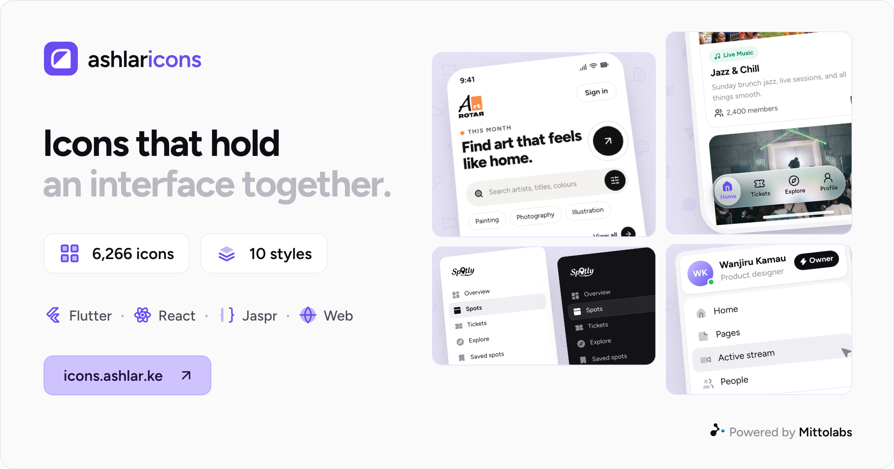

<p align="center">
  <a href="https://icons.ashlar.ke">
    
  </a>
</p>

<p align="center">
  6,266 icons in 10 matching styles, ready to install for Flutter, React, Jaspr and the web.
</p>

<p align="center">
  <a href="https://icons.ashlar.ke/icons"><b>Browse the icons</b></a>
  &nbsp;·&nbsp;
  <a href="https://icons.ashlar.ke/docs"><b>Docs</b></a>
  &nbsp;·&nbsp;
  <a href="LICENSE"><b>Licence</b></a>
</p>

<p align="center">
  <a href="LICENSE"></a>
</p>

## Packages

| Package | For | Install |
|---|---|---|
| [`ashlar_icons`](packages/ashlar_icons) | Flutter | `flutter pub add ashlar_icons` |
| [`@mittolabs/ashlar-icons-react`](packages/react) | React | `npm install @mittolabs/ashlar-icons-react` |
| [`ashlar_icons_jaspr`](packages/ashlar_icons_jaspr) | Jaspr | `dart pub add ashlar_icons_jaspr` |
| [`@mittolabs/ashlar-icons`](packages/web) | Any web page | `npm install @mittolabs/ashlar-icons` |
| [`@mittolabs/ashlar-icons-core`](packages/core) | Your own icon components | `npm install @mittolabs/ashlar-icons-core` |

Every package has the same icons and names, and releases share one version.

## Quick start

### Flutter

```dart
import 'package:ashlar_icons/ashlar_icons.dart';

Icon(AshlarIconsRoundedStroke.calendar)
Icon(AshlarIconsSharpSolid.calendar, size: 32)
```

### React

```tsx
import { CalendarIcon } from '@mittolabs/ashlar-icons-react';
import { CalendarIcon as SharpCalendarIcon } from '@mittolabs/ashlar-icons-react/sharp-solid';

<CalendarIcon className="size-4" />
<SharpCalendarIcon size={32} />
```

Only the icons you import end up in your bundle.

### Jaspr

```dart
import 'package:ashlar_icons_jaspr/ashlar_icons_jaspr.dart';

AshlarIcon(AshlarIconsRoundedStroke.calendar)
AshlarIcon(AshlarIconsSharpSolid.calendar, size: 32)
```

### Web

```html
<link rel="stylesheet" href="https://cdn.jsdelivr.net/npm/@mittolabs/ashlar-icons@0.1.0/ashlar-icons.css">

<i class="ash ash-rounded-stroke ash-calendar"></i>
<i class="ash ash-sharp-solid ash-calendar"></i>
```

Or download any icon as SVG or PNG from [icons.ashlar.ke](https://icons.ashlar.ke/icons).

## Styles

Every icon comes in all ten styles, so you can switch style, or mix them, and everything still lines up.

| | Stroke | Solid | Duotone | Twotone | Bulk |
|---|:---:|:---:|:---:|:---:|:---:|
| **Rounded** | ✓ | ✓ | ✓ | ✓ | ✓ |
| **Standard** | ✓ | ✓ | ✓ | | |
| **Sharp** | ✓ | ✓ | | | |

Each package's README covers sizing, colours and the two-colour styles.

## Licence

ISC, with the MIT notices of the designs it builds on. See [`LICENSE`](LICENSE).

<p align="center">
  <sub>Made by Mittolabs</sub>
</p>
